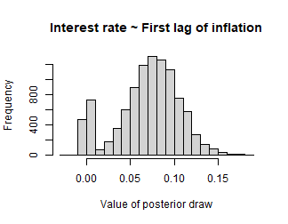

# Stochastic Search Variable Selection in bvartools

## Introduction

A general drawback of vector autoregressive (VAR) models is that the
number of estimated coefficients increases disproportionately with the
number of lags. Therefore, fewer information per parameter is available
for the estimation as the number of lags increases. In the Bayesian VAR
literature one approach to mitigate this so-called *curse of
dimensionality* is *stochastic search variable selection* (SSVS) as
proposed by George et al. (2008). The basic idea of SSVS is to assign
commonly used prior variances to parameters, which should be included in
a model, and prior variances close to zero to irrelevant parameters. By
that, relevant parameters are estimated in the usual way and posterior
draws of irrelevant variables are close to zero so that they have no
significant effect on forecasts and impulse responses. This is achieved
by adding a hierarchial prior to the model, where the relevance of a
variable is assessed in each step of the sampling algorithm.[^1]

Korobilis (2013) proposes a similar appraoch to variable selection,
which can also be applied to timy varying parameter models. The approach
is implemented in `bvartools` as function `bvs`, which can be easily
added to a standard Gibbs sampling algorithm. It is also implemented in
the posterior simulation algorithm of the package an can be specified
analogously to the last section of this introduction, where the use of
the built-in SSVS sampler is described.

This vignette presents code for Bayesian inference of a vector
autoregressive (BVAR) model using stochastic search variable selection.
It uses data set `at_macrodata`, which contains quarterly macroeconomic
series of Austria. A VAR(4) model is estimated for the growth rate of
real GDP (`dy`), inflation (`Dp`) and the short-term interest rate (`r`)
up to 2019Q4, which leaves out the quarters in which the pandemic moved
output growth by ten percent. The `bvartools` package can be used to
load the data and generate the data matrices for the model.

``` r

library(bvartools)

# Load and transform data
data("at_macrodata")
at <- at_macrodata[["domestic"]]
at <- ts.intersect(dy = diff(at[, "y"]), Dp = at[, "Dp"], r = at[, "r"])

# Shorten time series
at <- window(at, end = c(2019, 4))

# Generate VAR
data <- create_bvarmodel(at, p = 4, deterministic = "const",
                         varsel = "ssvs",
                         iterations = 10000, burnin = 5000)
```

`bvartools` allows to estimate BVAR models with SSVS either by using
algorithms that were written by the researchers themselves or by using
the built-in posterior simulation algorithm. The first approach is
presented in the following section. The latter approach is illustrated
at the end of this introduction.

## Inference based on a user-written algorithm

The prior variances of the parameters are set in accordance with the
semiautomatic approach described in George et al. (2008). Hence, the
prior variance of the $`i`$th parameter is set to
$`\tau_{1,i}^2 = (10 \hat{\sigma}_i)^2`$ if this parameter should be
included in the model and to $`\tau_{0,i}^2 = (0.1 \hat{\sigma}_i)^2`$
if it should be excluded. $`\hat{\sigma}_i`$ is the standard error
associated with the unconstrained least squares estimate of parameter
$`i`$. For all variables the prior inclusion probabilities are set to
0.5. The necessary calculations can be done with function `ssvs_prior`.
The prior of the error variance-covariance matrix is uninformative and,
in constrast to George et al. (2008), SSVS is not applied to the
covariances.

``` r

# Reset random number generator for reproducibility
set.seed(1234567)

# Get data matrices
y <- t(data$data$train$y)
x <- t(data$data$train$x)

tt <- ncol(y) # Number of observations
k <- nrow(y) # Number of endogenous variables
m <- k * nrow(x) # Number of estimated coefficients

# Coefficient priors
a_mu_prior <- matrix(0, m) # Vector of prior means

# SSVS priors (semiautomatic approach)
vs_prior <- ssvs_prior(data, semiautomatic = c(.1, 10))
tau0 <- vs_prior$tau0
tau1 <- vs_prior$tau1

# Prior for inclusion parameter
prob_prior <- matrix(0.5, m)

# Prior for variance-covariance matrix
u_sigma_df_prior <- 0 # Prior degrees of freedom
u_sigma_scale_prior <- diag(0.00001, k) # Prior covariance matrix
u_sigma_df_post <- tt + u_sigma_df_prior # Posterior degrees of freedom
```

The initial parameter values are set to zero and their corresponding
prior variances are set to $`\tau_1^2`$, which implies that all
parameters should be estimated relatively freely in the first step of
the Gibbs sampler.

``` r

# Initial values
a <- matrix(0, m)
a_v_i_prior <- diag(1 / c(tau1)^2, m) # Inverse of the prior covariance matrix

# Data containers for posterior draws
iterations <- 10000 # Number of saved iterations of the Gibbs sampler
burnin <- 5000 # Number of burn-in draws
draws <- iterations + burnin # Total number of draws

draws_a <- matrix(NA, m, iterations)
draws_lambda <- matrix(NA, m, iterations)
draws_sigma <- matrix(NA, k^2, iterations)
```

SSVS can be added to a standard Gibbs sampler algorithm for VAR models
in a straightforward manner. The `ssvs` function can be used to obtain a
draw of inclusion parameters and its corresponding inverted prior
variance matrix. It requires the current draw of parameters, standard
errors $`\tau_0`$ and $`\tau_1`$, and prior inclusion probabilities as
arguments. In this example constant terms are excluded from SSVS, which
is achieved by specifying `include = 1:36`. Hence, only parameters 1 to
36 are considered by the function and the remaining three parameters
have prior variances that correspond to their values in $`\tau_1^2`$.

``` r

# Start Gibbs sampler
for (draw in 1:draws) {
  # Draw variance-covariance matrix
  u <- y - matrix(a, k) %*% x # Obtain residuals
  # Scale posterior
  u_sigma_scale_post <- solve(u_sigma_scale_prior + tcrossprod(u))
  # Draw posterior of inverse sigma
  u_sigma_i <- matrix(rWishart(1, u_sigma_df_post, u_sigma_scale_post)[,, 1], k)
  # Obtain sigma
  u_sigma <- solve(u_sigma_i)
  
  # Draw conditional mean parameters
  a <- post_normal(y, x, u_sigma_i, a_mu_prior, a_v_i_prior)
  
  # Draw inclusion parameters and update priors
  temp <- ssvs(a, tau0, tau1, prob_prior, include = 1:36)
  a_v_i_prior <- temp$v_i # Update prior
  
  # Store draws
  if (draw > burnin) {
    draws_a[, draw - burnin] <- a
    draws_lambda[, draw - burnin] <- temp$lambda
    draws_sigma[, draw - burnin] <- u_sigma
  }
}
```

The output of a Gibbs sampler with SSVS can be further analysed in the
usual way. With the `bvartools` package the posterior draws can be
collected in a `bvarmodel` object and the `summary` method provides
summary statistics. It is also possible to add information on the
inclusion parameters to the `bvarmodel` object by providing a named list
as an argument. The list must contain an element `coeffs`, which
contains the MCMC draws of the coefficients, and element `lambda`
contains the corresponding draw of the inclusion parameter. Argument
`varsel` names the algorithm that produced the draws, since the draws
themselves do not reveal it.

``` r

bvar_est <- bvar(y = data$data$train$y, x = data$data$train$x,
                 A = list(coeffs = draws_a[1:36,],
                          lambda = draws_lambda[1:36,]),
                 C = list(coeffs = draws_a[37:39, ],
                          lambda = draws_lambda[37:39,]),
                 Sigma = draws_sigma,
                 varsel = "ssvs")

bvar_summary <- summary(bvar_est)

bvar_summary
#> 
#> Bayesian VAR model with p = 4 
#> 
#> Variable selection algorithm: Stochastic search variable selection (George et al., 2008)
#> 
#> Endogenous variables: dy, Dp, r
#> 
#> Variable: dy 
#> 
#>            Mean       SD  Naive SD Time-series SD      2.5%        50%    97.5%
#> dy.l1 -0.010383 0.039081 3.908e-04      9.984e-04 -0.146636 -0.0018081 0.017969
#> Dp.l1 -0.002481 0.072098 7.210e-04      1.131e-03 -0.133075 -0.0011605 0.097650
#> r.l1   0.021640 0.103103 1.031e-03      1.606e-03 -0.131009  0.0161154 0.197643
#> dy.l2 -0.003671 0.028232 2.823e-04      3.799e-04 -0.081217 -0.0008370 0.025820
#> Dp.l2 -0.162479 0.237696 2.377e-03      1.242e-02 -0.733684 -0.0261429 0.041151
#> r.l2   0.024352 0.128258 1.283e-03      1.591e-03 -0.179150  0.0228896 0.237074
#> dy.l3 -0.005262 0.030362 3.036e-04      5.522e-04 -0.098510 -0.0012868 0.021099
#> Dp.l3 -0.079307 0.172836 1.728e-03      6.571e-03 -0.591042 -0.0128792 0.046407
#> r.l3   0.029351 0.121774 1.218e-03      1.405e-03 -0.175081  0.0289937 0.227821
#> dy.l4  0.004614 0.029180 2.918e-04      4.980e-04 -0.021676  0.0008465 0.091433
#> Dp.l4  0.002746 0.068664 6.866e-04      1.151e-03 -0.088170  0.0006907 0.141554
#> r.l4   0.006403 0.083260 8.326e-04      9.889e-04 -0.129874  0.0063108 0.144074
#> const  0.005642 0.001493 1.493e-05      3.824e-05  0.002906  0.0055805 0.008716
#>       Incl. prob.  
#> dy.l1      0.1270  
#> Dp.l1      0.0834  
#> r.l1       0.0418  
#> dy.l2      0.0973  
#> Dp.l2      0.3849  
#> r.l2       0.0297  
#> dy.l3      0.0952  
#> Dp.l3      0.2325  
#> r.l3       0.0272  
#> dy.l4      0.0974  
#> Dp.l4      0.0798  
#> r.l4       0.0291  
#> const      1.0000 *
#> 
#> Variable: Dp 
#> 
#>            Mean        SD  Naive SD Time-series SD       2.5%        50%
#> dy.l1  0.010318 0.0233090 2.331e-04      8.882e-04 -0.0060357  0.0013370
#> Dp.l1  0.307180 0.0912453 9.125e-04      4.030e-03  0.1210521  0.3089691
#> r.l1   0.028033 0.0641199 6.412e-04      1.682e-03 -0.0382228  0.0161397
#> dy.l2  0.025594 0.0344396 3.444e-04      1.639e-03 -0.0051395  0.0040904
#> Dp.l2  0.184739 0.1205947 1.206e-03      8.361e-03 -0.0091521  0.2050620
#> r.l2   0.022900 0.0568687 5.687e-04      1.052e-03 -0.0599709  0.0232240
#> dy.l3 -0.001828 0.0114083 1.141e-04      2.067e-04 -0.0383733 -0.0003047
#> Dp.l3  0.083785 0.1053519 1.054e-03      6.510e-03 -0.0139819  0.0139236
#> r.l3   0.018244 0.0452134 4.521e-04      6.105e-04 -0.0606518  0.0185892
#> dy.l4 -0.009217 0.0216023 2.160e-04      8.026e-04 -0.0763921 -0.0014055
#> Dp.l4  0.003308 0.0264096 2.641e-04      5.433e-04 -0.0206218  0.0009119
#> r.l4   0.010510 0.0347402 3.474e-04      4.972e-04 -0.0409060  0.0081117
#> const  0.001573 0.0006068 6.068e-06      1.733e-05  0.0003505  0.0015782
#>          97.5% Incl. prob.  
#> dy.l1 0.079318      0.2323  
#> Dp.l1 0.479050      0.9890 *
#> r.l1  0.207629      0.1066  
#> dy.l2 0.104311      0.4307  
#> Dp.l2 0.385992      0.7905  
#> r.l2  0.119104      0.0521  
#> dy.l3 0.008785      0.1075  
#> Dp.l3 0.314253      0.4669  
#> r.l3  0.098383      0.0386  
#> dy.l4 0.005810      0.2097  
#> Dp.l4 0.074557      0.0754  
#> r.l4  0.081195      0.0545  
#> const 0.002755      1.0000 *
#> 
#> Variable: r 
#> 
#>             Mean        SD  Naive SD Time-series SD       2.5%        50%
#> dy.l1  0.0367449 0.0105465 1.055e-04      0.0005714  0.0136717  0.0372129
#> Dp.l1  0.0698199 0.0353575 3.536e-04      0.0023645 -0.0014611  0.0742112
#> r.l1   1.0642254 0.0619080 6.191e-04      0.0024235  0.9539354  1.0665793
#> dy.l2  0.0014138 0.0051625 5.162e-05      0.0001862 -0.0022302  0.0001929
#> Dp.l2 -0.0087571 0.0210130 2.101e-04      0.0009418 -0.0739440 -0.0010349
#> r.l2  -0.0143039 0.0551805 5.518e-04      0.0023539 -0.2026002 -0.0023530
#> dy.l3  0.0037121 0.0079920 7.992e-05      0.0003373 -0.0019057  0.0004688
#> Dp.l3 -0.0149248 0.0266669 2.667e-04      0.0015617 -0.0853984 -0.0018327
#> r.l3   0.0040835 0.0623423 6.234e-04      0.0024328 -0.1340619 -0.0004697
#> dy.l4  0.0026692 0.0068463 6.846e-05      0.0002787 -0.0018874  0.0003572
#> Dp.l4 -0.0329379 0.0347871 3.479e-04      0.0021077 -0.1029683 -0.0253848
#> r.l4  -0.0832672 0.0683361 6.834e-04      0.0038885 -0.2292843 -0.0907439
#> const -0.0001539 0.0002152 2.152e-06      0.0000081 -0.0005897 -0.0001503
#>           97.5% Incl. prob.  
#> dy.l1 0.0556771      0.9808 *
#> Dp.l1 0.1301581      0.8845  
#> r.l1  1.1949354      1.0000 *
#> dy.l2 0.0190459      0.1430  
#> Dp.l2 0.0052493      0.2143  
#> r.l2  0.0290875      0.1347  
#> dy.l3 0.0273353      0.2529  
#> Dp.l3 0.0049911      0.3125  
#> r.l3  0.1958832      0.1819  
#> dy.l4 0.0245789      0.1953  
#> Dp.l4 0.0038579      0.5607  
#> r.l4  0.0076375      0.6858  
#> const 0.0002586      1.0000  
#> 
#> Variance-covariance matrix:
#> 
#>            Mean        SD  Naive SD Time-series SD       2.5%       50%
#> dy_dy 8.696e-05 1.025e-05 1.025e-07      1.059e-07  6.891e-05 8.642e-05
#> dy_Dp 1.888e-06 2.661e-06 2.661e-08      3.403e-08 -3.279e-06 1.863e-06
#> dy_r  1.581e-06 8.421e-07 8.421e-09      1.160e-08 -3.095e-08 1.559e-06
#> Dp_Dp 1.138e-05 1.342e-06 1.342e-08      1.566e-08  9.002e-06 1.128e-05
#> Dp_r  7.962e-07 3.092e-07 3.092e-09      3.798e-09  2.079e-07 7.825e-07
#> r_r   1.121e-06 1.369e-07 1.369e-09      2.473e-09  8.836e-07 1.111e-06
#>           97.5%  
#> dy_dy 1.090e-04 *
#> dy_Dp 7.314e-06  
#> dy_r  3.304e-06  
#> Dp_Dp 1.435e-05 *
#> Dp_r  1.424e-06 *
#> r_r   1.420e-06 *
```

The inclusion probabilities of the constant terms are 100 percent,
because they were excluded from SSVS.

Using the results from above the researcher could proceed in the usual
way and obtain forecasts and impulse responses based on the output of
the Gibbs sampler. The advantage of this approach is that it does not
only take into account parameter uncertainty, but also model
uncertainty. This can be illustrated by the histogram of the posterior
draws of the 6th coefficient, which describes the relationship between
the first lag of inflation and the current value of the interest rate.

``` r

hist(draws_a[6,], main = "Interest rate ~ First lag of inflation", xlab = "Value of posterior draw")
```



plot of chunk histogram

A non-negligible mass of some 12 percent, i.e. 1 - 0.88, of the
parameter draws is concentrated around zero. This is the result of SSVS,
where posterior draws are close to zero if a coefficient is assessed to
be irrelevant during an iteration of the Gibbs sampler and, therefore,
$`\tau_{0,6}^2`$ is used as its prior variance. On the other hand, about
88 percent of the draws are dispersed around a positive value, where
SSVS suggests to include the variable in the model and the larger value
$`\tau_{1,6}^2`$ is used as prior variance. Model uncertainty is then
described by the two peaks and parameter uncertainty by the dispersion
of the posterior draws around them.

However, if the researcher prefers not to work with a model, where the
relevance of a variable can change from one step of the sampling
algorithm to the next, a different approach would be to work only with a
highly probable model. This can be done with a further simulation, where
very tight priors are used for irrelevant variables and relatively
uninformative priors for relevant parameters. In this example,
coefficients with a posterior inclusion probability of at least 50
percent are considered to be relevant. The prior variance is set to
0.00001 for irrelevant and to 9 for relevant variables. No additional
SSVS step is required. Everything else remains unchanged.

``` r

# Get inclusion probabilities
lambda <- bvar_summary$a$lambda

# Select variables that should be included
include_var <- c(lambda >= .5)

# Update prior variances
diag(a_v_i_prior)[!include_var] <- 1 / 0.00001 # Very tight prior close to zero
diag(a_v_i_prior)[include_var] <- 1 / 9 # Relatively uninformative prior

# Data containers for posterior draws
draws_a <- matrix(NA, m, iterations)
draws_sigma <- matrix(NA, k^2, iterations)

# Start Gibbs sampler
for (draw in 1:draws) {
  # Draw conditional mean parameters
  a <- post_normal(y, x, u_sigma_i, a_mu_prior, a_v_i_prior)
  
  # Draw variance-covariance matrix
  u <- y - matrix(a, k) %*% x # Obtain residuals
  u_sigma_scale_post <- solve(u_sigma_scale_prior + tcrossprod(u))
  u_sigma_i <- matrix(rWishart(1, u_sigma_df_post, u_sigma_scale_post)[,, 1], k)
  u_sigma <- solve(u_sigma_i) # Invert Sigma_i to obtain Sigma
  
  # Store draws
  if (draw > burnin) {
    draws_a[, draw - burnin] <- a
    draws_sigma[, draw - burnin] <- u_sigma
  }
}
```

Summary statistics of the posterior draws of the restricted model:

``` r

bvar_est <- bvar(y = data$data$train$y,
                 x = data$data$train$x,
                 A = draws_a[1:36,],
                 C = draws_a[37:39, ],
                 Sigma = draws_sigma)

summary(bvar_est)
#> 
#> Bayesian VAR model with p = 4 
#> 
#> Endogenous variables: dy, Dp, r
#> 
#> Variable: dy 
#> 
#>             Mean       SD  Naive SD Time-series SD      2.5%        50%
#> dy.l1 -1.010e-04 0.003170 3.170e-05      3.170e-05 -0.006502 -8.346e-05
#> Dp.l1 -5.871e-05 0.003183 3.183e-05      3.183e-05 -0.006300 -3.984e-05
#> r.l1  -6.931e-05 0.003119 3.119e-05      3.119e-05 -0.006299 -4.593e-05
#> dy.l2 -6.608e-05 0.003156 3.156e-05      3.156e-05 -0.006339 -1.022e-04
#> Dp.l2 -1.270e-04 0.003106 3.106e-05      3.106e-05 -0.006187 -1.336e-04
#> r.l2  -2.371e-06 0.003168 3.168e-05      3.168e-05 -0.006173 -1.067e-05
#> dy.l3 -9.361e-05 0.003170 3.170e-05      3.170e-05 -0.006343 -1.210e-04
#> Dp.l3 -1.302e-04 0.003160 3.160e-05      3.160e-05 -0.006326 -1.124e-04
#> r.l3   4.044e-05 0.003133 3.133e-05      3.133e-05 -0.006144  4.325e-05
#> dy.l4  4.063e-05 0.003170 3.170e-05      3.170e-05 -0.006169  2.285e-05
#> Dp.l4  7.178e-06 0.003124 3.124e-05      3.124e-05 -0.006107  4.418e-05
#> r.l4   1.574e-05 0.003161 3.161e-05      3.137e-05 -0.006247  4.158e-05
#> const  4.858e-03 0.000758 7.580e-06      7.580e-06  0.003397  4.856e-03
#>          97.5%  
#> dy.l1 0.006056  
#> Dp.l1 0.006200  
#> r.l1  0.005986  
#> dy.l2 0.006134  
#> Dp.l2 0.005915  
#> r.l2  0.006226  
#> dy.l3 0.006120  
#> Dp.l3 0.006171  
#> r.l3  0.006202  
#> dy.l4 0.006228  
#> Dp.l4 0.006146  
#> r.l4  0.006161  
#> const 0.006342 *
#> 
#> Variable: Dp 
#> 
#>             Mean        SD  Naive SD Time-series SD       2.5%        50%
#> dy.l1  0.0003687 0.0031244 3.124e-05      3.124e-05 -0.0057263  0.0003483
#> Dp.l1  0.3701423 0.0768036 7.680e-04      7.899e-04  0.2185441  0.3712270
#> r.l1   0.0005123 0.0031485 3.148e-05      3.047e-05 -0.0055597  0.0005343
#> dy.l2  0.0006110 0.0031356 3.136e-05      3.136e-05 -0.0055824  0.0006542
#> Dp.l2  0.3015228 0.0760091 7.601e-04      7.878e-04  0.1504480  0.3020475
#> r.l2   0.0005171 0.0031900 3.190e-05      3.190e-05 -0.0057424  0.0004973
#> dy.l3 -0.0002423 0.0031332 3.133e-05      3.133e-05 -0.0063573 -0.0002184
#> Dp.l3  0.0003634 0.0031498 3.150e-05      3.150e-05 -0.0058036  0.0003587
#> r.l3   0.0004960 0.0031686 3.169e-05      3.169e-05 -0.0057789  0.0005136
#> dy.l4 -0.0005207 0.0031688 3.169e-05      3.169e-05 -0.0067339 -0.0005094
#> Dp.l4  0.0001235 0.0031642 3.164e-05      3.095e-05 -0.0061268  0.0001720
#> r.l4   0.0004903 0.0031499 3.150e-05      3.150e-05 -0.0056310  0.0004524
#> const  0.0018653 0.0005116 5.116e-06      5.212e-06  0.0008483  0.0018663
#>          97.5%  
#> dy.l1 0.006406  
#> Dp.l1 0.520167 *
#> r.l1  0.006759  
#> dy.l2 0.006666  
#> Dp.l2 0.448662 *
#> r.l2  0.006725  
#> dy.l3 0.005881  
#> Dp.l3 0.006499  
#> r.l3  0.006685  
#> dy.l4 0.005645  
#> Dp.l4 0.006257  
#> r.l4  0.006624  
#> const 0.002865 *
#> 
#> Variable: r 
#> 
#>             Mean        SD  Naive SD Time-series SD       2.5%        50%
#> dy.l1  3.729e-02 0.0087963 8.796e-05      8.796e-05  0.0198667  3.733e-02
#> Dp.l1  8.242e-02 0.0241856 2.419e-04      2.545e-04  0.0349572  8.239e-02
#> r.l1   1.068e+00 0.0325932 3.259e-04      3.259e-04  1.0041518  1.068e+00
#> dy.l2  3.969e-04 0.0030055 3.005e-05      3.005e-05 -0.0055449  3.985e-04
#> Dp.l2 -4.749e-04 0.0031138 3.114e-05      3.186e-05 -0.0065405 -4.475e-04
#> r.l2  -2.324e-05 0.0031698 3.170e-05      3.170e-05 -0.0062437 -1.003e-05
#> dy.l3  1.150e-03 0.0030134 3.013e-05      2.946e-05 -0.0048257  1.185e-03
#> Dp.l3 -6.574e-04 0.0031741 3.174e-05      3.174e-05 -0.0068923 -6.661e-04
#> r.l3   1.534e-04 0.0031715 3.172e-05      3.110e-05 -0.0060840  1.614e-04
#> dy.l4  1.006e-03 0.0029768 2.977e-05      2.977e-05 -0.0048697  1.040e-03
#> Dp.l4 -6.017e-02 0.0233862 2.339e-04      2.339e-04 -0.1063599 -6.020e-02
#> r.l4  -1.032e-01 0.0311174 3.112e-04      3.112e-04 -0.1646503 -1.031e-01
#> const -1.119e-04 0.0001734 1.734e-06      1.734e-06 -0.0004517 -1.108e-04
#>            97.5%  
#> dy.l1  0.0544317 *
#> Dp.l1  0.1295685 *
#> r.l1   1.1308588 *
#> dy.l2  0.0062115  
#> Dp.l2  0.0056027  
#> r.l2   0.0061931  
#> dy.l3  0.0070925  
#> Dp.l3  0.0055353  
#> r.l3   0.0063634  
#> dy.l4  0.0068378  
#> Dp.l4 -0.0139662 *
#> r.l4  -0.0420892 *
#> const  0.0002351  
#> 
#> Variance-covariance matrix:
#> 
#>            Mean        SD  Naive SD Time-series SD       2.5%       50%
#> dy_dy 8.749e-05 9.982e-06 9.982e-08      9.982e-08  7.007e-05 8.669e-05
#> dy_Dp 2.199e-06 2.661e-06 2.661e-08      2.718e-08 -3.006e-06 2.161e-06
#> dy_r  1.727e-06 8.082e-07 8.082e-09      8.227e-09  1.987e-07 1.700e-06
#> Dp_Dp 1.187e-05 1.392e-06 1.392e-08      1.440e-08  9.442e-06 1.177e-05
#> Dp_r  8.068e-07 3.100e-07 3.100e-09      3.338e-09  2.351e-07 7.975e-07
#> r_r   1.092e-06 1.285e-07 1.285e-09      1.362e-09  8.697e-07 1.080e-06
#>           97.5%  
#> dy_dy 1.091e-04 *
#> dy_Dp 7.506e-06  
#> dy_r  3.417e-06 *
#> Dp_Dp 1.491e-05 *
#> Dp_r  1.453e-06 *
#> r_r   1.369e-06 *
```

Forecasts, impulse responses and variance decompositions can be obtained
in the usual manner.

## Using the built-in simulation algorithm of `bvartools`

Priors can be added to object `data` using function `add_priors`. To use
the same specification as above, argument `ssvs` is a named list, where
element `inprior` contains the prior probability that a coefficient
enters a model, element `semiautomatic` contains the factors used to
obtain $`tau_0`$ and $`tau_1`$ based on the semiautomatic approach of
George et al. (2008) and `exclude_det = TRUE` tells the algorithm to
exclude deterministic terms from the SSVS algorithm.

``` r

# Obtain priors
model_with_priors <- add_priors(data,
                                coef = list(v_i = 0),
                                sigma = list(df = 1, scale = 0.00001),
                                varsel = list(inprior = 0.5, semiautomatic = c(0.01, 10), exclude_det = TRUE))
```

Initial values can be added to the model by using function
`add_initial_values`.

``` r

model_with_priors <- add_initial_values(model_with_priors)
```

Posterior draws can be obtained using function
`add_posterior_coefficients`. It will recognise the specifications of
the model based on the content of object `model_with_priors` and produce
the respective draws from the posterior.

``` r

ssvs_est <- add_posterior_coefficients(model_with_priors)
```

The output of `add_posterior_coefficients` is an object of class
`bvarmodel`. Thus, further analytical steps can be done as described
above.

## Citing bvartools

If you use `bvartools` in published work, please cite it.
`citation("bvartools")` prints the reference, and the package has the
DOI [10.5281/zenodo.22736604](https://doi.org/10.5281/zenodo.22736604),
which always resolves to the latest archived version.

## References

Chan, J., Koop, G., Poirier, D. J., & Tobias, J. L. (2019). *Bayesian
Econometric Methods* (2nd ed.). Cambridge: University Press.

George, E. I., Sun, D., & Ni, S. (2008). Bayesian stochastic search for
VAR model restrictions. *Journal of Econometrics, 142*(1), 553-580.
<https://doi.org/10.1016/j.jeconom.2007.08.017>

Koop, G., & Korobilis, D. (2010). Bayesian multivariate time series
methods for empirical macroeconomics. *Foundations and trends in
econometrics, 3*(4), 267-358. <https://dx.doi.org/10.1561/0800000013>

Korobilis, D. (2013). VAR forecasting using Bayesian variable selection.
*Journal of Applied Econometrics, 28*(2), 204-230.
<https://doi.org/10.1002/jae.1271>

[^1]: See Koop and Korobilis (2010) for an introduction to Bayesian VAR
    modelling and SSVS.
